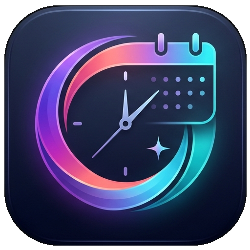

<div align="center">
  
  <h1>⏱️ Chronos – AI Day Planner</h1>
  <p><strong>Dein KI-gestützter Tagesplaner, der normale Alltagssätze in strukturierte Google-Kalender-Termine verwandelt.</strong></p>
</div>

---

## 💡 Was macht Chronos?

Mit **Chronos** musst du Termine nicht mehr mühsam einzeln im Kalender zusammenklicken. Du tippst einfach in normaler Sprache ein, was ansteht – zum Beispiel:

> *„Morgen von 7:30 bis 8:50 Uhr Arbeit, um 9 Uhr kurzer Reminder für meine Daily News und abends um 20:45 Uhr spielt Bayern im Pokal.“*

**Chronos erledigt den Rest vollautomatisch:**
1. 🧠 **KI-Analyse (Google Gemini):** Erkennt alle Termine, berechnet das genaue Datum sowie Start- und Endzeiten und weist passende Kategorien (*Work*, *Meeting*, *Deep Work*, *Health*, *Personal*, *Sonstiges*) zu.
2. 📍 **Orte & Intelligente Erinnerungen:** Genannte Orte (z. B. *„im Paulaner am Nockherberg“*) landen direkt im Google-Maps-Ortsfeld des Kalenders. Benachrichtigungen bleiben standardmäßig aus und werden nur aktiviert, wenn du explizit darum bittest (z. B. *„erinnere mich 15 Min vorher“*).
3. ⚡ **Globaler Spotlight-Schnellzugriff (`Alt + C`):** Überall in Windows per Tastenkürzel einblendbar (mit sanfter Slide-&-Fade-Animation, frei verschiebbar inkl. Positionsspeicher) – tippen, `Enter` drücken, fertig!
4. ✏️ **Vorschau & Anpassung:** In der Haupt-App kannst du Titel, Kategorie, Ort, Erinnerung oder Notizen vorab mit einem Klick anpassen oder Termine löschen.
5. 📅 **1-Klick Google Calendar Sync:** Trägt alle Termine inklusive passender Kalenderfarben direkt in deinen echten Google Kalender ein.

> **💰 Kostenhinweis:** Dieses Projekt nutzt ausschließlich **100 % kostenlose Tarife (Free Tier)** von Google AI Studio und der Google Calendar API. Es wird **keine Kreditkarte** und **kein Abrechnungskonto** benötigt!

---

## 🛠️ Voraussetzungen (Was du vorab auf deinem PC brauchst)

Bevor du startest, stelle sicher, dass diese drei Dinge vorhanden sind:

1. **Python (Version 3.11 oder neuer):**
   * Hier kostenlos herunterladen: [python.org/downloads](https://www.python.org/downloads/)
   * ⚠️ **Wichtig bei der Installation unter Windows:** Setze ganz unten im Installationsfenster unbedingt das Häkchen bei **„Add python.exe to PATH“**!
2. **Node.js (LTS-Version):**
   * Hier kostenlos herunterladen: [nodejs.org](https://nodejs.org/) (einfach den linken *LTS*-Button wählen und durchklicken).
3. **Ein normales, kostenloses Google-Konto (Gmail):**
   * Damit erstellen wir gleich deinen kostenlosen KI-Schlüssel und verbinden deinen Google Kalender.

---

## 🚀 Schritt-für-Schritt-Einrichtung (Auch für Einsteiger!)

Folge einfach diesen **5 Schritten**, um Chronos bei dir einzurichten.

---

### Schritt 1: Projekt herunterladen & Pakete installieren

Öffne **PowerShell** (oder die Eingabeaufforderung) im Projektordner `chronos` und führe nacheinander diese Befehle aus:

#### 1.1 Backend (Python) einrichten
```powershell
# 1. Eigene Python-Umgebung (.venv) erstellen
python -m venv .venv

# 2. Python-Umgebung aktivieren
.\.venv\Scripts\Activate.ps1

# 3. Alle benötigten Python-Pakete installieren
pip install -r requirements.txt
```
*(Tipp: Falls Windows bei `Activate.ps1` meckert, gib einmalig `Set-ExecutionPolicy -Scope CurrentUser RemoteSigned` ein und bestätige mit `J`.)*

#### 1.2 Frontend (Next.js) einrichten
```powershell
# In den Frontend-Ordner wechseln und Pakete installieren
cd frontend
npm install
cd ..
```

---

### Schritt 2: Kostenlosen Gemini KI-Schlüssel holen (dauert 1 Minute)

Damit Chronos deine Texte versteht, brauchst du einen kostenlosen API-Key aus dem **Google AI Studio**:

1. Öffne [https://aistudio.google.com/app/apikey](https://aistudio.google.com/app/apikey) und melde dich mit deinem Google-Konto an.
2. Klicke oben rechts auf **„API-Schlüssel erstellen“ (Create API key)**.
3. Kopiere den angezeigten Schlüssel (er steht auf *„Kostenlose Stufe“*).
4. Bewahre ihn kurz in der Zwischenablage für **Schritt 4** auf.

---

### Schritt 3: Google Calendar Zugang einrichten (einmalig, 100 % kostenlos)

Damit deine eigene Chronos-App Termine in deinen Google Kalender eintragen darf, erstellst du dir in der Google Cloud Console einen eigenen Schlüssel (`Client-ID` & `Client-Secret`):

1. **Projekt anlegen:**
   * Gehe auf [https://console.cloud.google.com/](https://console.cloud.google.com/).
   * Klicke oben links neben dem Google-Cloud-Logo auf die Projektauswahl und wähle **„Neues Projekt“ (New Project)**.
   * Gib ihm den Namen `Chronos` und klicke auf **Erstellen**.
2. **Google Calendar API aktivieren:**
   * Öffne diesen Link (oder suche oben in der Suchleiste nach *Google Calendar API*): [https://console.cloud.google.com/apis/library/calendar-json.googleapis.com](https://console.cloud.google.com/apis/library/calendar-json.googleapis.com)
   * Klicke auf den blauen Button **„Aktivieren“ (Enable)**.
3. **Zustimmungsbildschirm (OAuth Consent Screen) konfigurieren:**
   * Gehe links im Menü auf **APIs & Dienste** -> **OAuth-Zustimmungsbildschirm** (oder *Google Auth Platform*).
   * Wähle als Nutzertyp **„Extern“ (External)** und klicke auf **Erstellen**.
   * Trage als App-Name `Chronos` und bei den Pflichtfeldern deine eigene E-Mail-Adresse ein. Klicke dich mit **Speichern und fortfahren** durch.
   * ⚠️ **WICHTIG – Testnutzer eintragen:** Unter dem Punkt **„Testnutzer“ (Audience / Test users)** klickst du auf **„+ Add Users“** und trägst **deine eigene Gmail-Adresse** ein! *(Solange deine App im Testmodus ist, lässt Google nur E-Mail-Adressen rein, die hier als Testnutzer eingetragen sind).*
4. **Client-ID & Secret erstellen:**
   * Gehe links auf **APIs & Dienste** -> **Anmeldedaten (Credentials)**.
   * Klicke oben auf **„+ Anmeldedaten erstellen“** -> **„OAuth-Client-ID“**.
   * Wähle als Anwendungstyp **„Webanwendung“ (Web application)**.
   * Scrolle runter zu **„Autorisierte Weiterleitungs-URIs“ (Authorized redirect URIs)**, klicke auf **„+ URI hinzufügen“** und trage **exakt** diese Adresse ein:
     ```text
     http://localhost:8000/api/auth/callback
     ```
   * Klicke auf **Erstellen**.
   * Jetzt zeigt Google dir deine **Client-ID** und deinen **Clientschlüssel (Client Secret)** an – kopiere dir beide für den nächsten Schritt!

---

### Schritt 4: Die `.env`-Datei ausfüllen

Im Projektordner findest du eine Vorlage-Datei namens **`.env.example`**.

1. Erstelle eine Kopie von `.env.example` und nenne die Kopie **`.env`** (ohne `.example` am Ende):
   ```powershell
   Copy-Item .env.example .env
   ```
2. Öffne die neue Datei **`.env`** mit einem beliebigen Texteditor (z. B. Notepad oder VS Code) und trage deine drei Schlüssel aus Schritt 2 & 3 ein:
   ```env
   GEMINI_API_KEY="Dein_Gemini_Key_aus_Schritt_2"
   GEMINI_MODEL="gemini-2.5-flash"

   GOOGLE_CLIENT_ID="Deine_Client_ID_aus_Schritt_3.apps.googleusercontent.com"
   GOOGLE_CLIENT_SECRET="Dein_Client_Secret_aus_Schritt_3"
   GOOGLE_REDIRECT_URI="http://localhost:8000/api/auth/callback"

   BACKEND_PORT=8000
   FRONTEND_URL="http://localhost:3000"
   ```
3. Speichere die Datei `.env`.

*(Hinweis: Es gibt außerdem eine `token.json.example` und `frontend/.env.local.example` zur Orientierung. Die echte `token.json` musst du **nicht** selbst anlegen – das macht Chronos beim ersten Login automatisch!)*

---

### Schritt 5: Chronos starten & benutzen! 🎉

Du hast **zwei Möglichkeiten**, Chronos zu starten:

#### Variante A: Der 1-Klick Desktop-Starter (`Chronos.exe` – Empfohlen unter Windows)
Klicke im Projektordner einfach doppelt auf **`Chronos.exe`** (oder `start-chronos.bat`)!
* Chronos startet das Python-Backend und das Next.js-Frontend vollautomatisch im Hintergrund (ohne störende schwarze Terminal-Fenster).
* Die App öffnet sich als eigenes schlankes Desktop-Fenster.
* Unten rechts in der Windows-Taskleiste (neben der Uhr im System-Tray) erscheint das **Chronos-Icon**:
  * **⚡ Globaler Shortcut (`Alt + C` oder `Strg + Umschalt + C`):** Drücke diesen Shortcut überall unter Windows, damit die schwebende Schnellzugriff-Leiste (Spotlight/Raycast-Style) sanft mit einer Slide-&-Fade-Animation einblendet:
    * **`Enter`:** Analysiert deine Eingabe und trägt den Termin direkt im Hintergrund in den Google Kalender ein.
    * **`Tab`:** Übernimmt deine Eingabe direkt in das große Chronos-Hauptfenster zur detaillierten Vorschau.
    * **`Esc` (oder Klick daneben):** Blendet die Leiste sanft wieder aus.
    * **Frei bewegbar (Drag & Move):** Halte die linke Maustaste auf dem Rahmen, Icon oder der Statusleiste gedrückt, um das Fenster frei zu verschieben – Chronos merkt sich deine Wunschposition automatisch!
  * **Doppelklick auf das Tray-Icon:** Öffnet sofort wieder das Chronos-Hauptfenster.
  * **Rechtsklick auf das Tray-Icon:** Bietet schnellen Zugriff auf die Leiste, **„Schnellzugriff-Position zentrieren“** (zum Zurücksetzen der Fensterposition), die API-Docs sowie **„Chronos beenden (Server stoppen)“**.
* *Tipp:* Erstelle dir per Rechtsklick auf `Chronos.exe` -> *Senden an -> Desktop (Verknüpfung erstellen)* eine Verknüpfung auf deinem Desktop!

#### Variante B: Manuell im Terminal starten (für Entwickler / Mac / Linux)
Starte zwei Terminals im Projektordner:

* **Terminal 1 (Backend):**
  ```powershell
  .\.venv\Scripts\Activate.ps1
  uvicorn backend.main:app --reload --port 8000
  ```
* **Terminal 2 (Frontend):**
  ```powershell
  cd frontend
  npm run dev
  ```
* Öffne danach im Browser: **http://localhost:3000**

#### 🔗 Einmalig mit Google Calendar verbinden
1. Klicke oben rechts in der Chronos-Oberfläche auf **„Mit Google Calendar verbinden“**.
2. Wähle dein Google-Konto aus.
3. Falls Google anzeigt *„Google hat diese App nicht überprüft“* (weil es deine eigene private App im Testmodus ist), klicke unten links auf **„Erweitert“ (Advanced)** -> **„Weiter zu Chronos (unsicher)“** und setze das Häkchen für den Kalenderzugriff.
4. Fertig! Oben rechts leuchtet jetzt **🟢 Google Calendar verbunden** – ab sofort bist du dauerhaft eingeloggt (`token.json` wurde gespeichert).

---

## 📂 Projektstruktur im Überblick

```text
chronos/
├── backend/
│   ├── api/routes.py             # FastAPI-Endpunkte (/api/parse, /api/quick-schedule, /api/auth/*, /api/calendar/sync)
│   ├── core/config.py            # Lädt die Schlüssel aus der .env-Datei
│   ├── models/schemas.py         # Strikte Pydantic-Datenmodelle für KI & Kalender (inkl. Ort & Erinnerungen)
│   ├── services/ai_scheduler.py  # Gemini KI-Integration (Structured JSON Output)
│   ├── services/calendar_service.py # Google Calendar OAuth2 & Event-Sync
│   └── main.py                   # FastAPI Hauptserver inkl. CORS
├── frontend/
│   ├── src/app/page.tsx          # Haupt-Benutzeroberfläche (Next.js + Tailwind + Lucide)
│   ├── src/lib/api.ts            # Kommunikation zwischen Frontend und Backend
│   └── .env.local.example        # Optionale Vorlage für die Backend-URL
├── launcher/
│   └── ChronosLauncher.cs        # Quellcode für die Windows-Executable & Spotlight-Leiste (Chronos.exe)
├── .env.example                  # Vorlage für deine API-Schlüssel (zu .env kopieren!)
├── token.json.example            # Beispiel-Struktur des automatisch erzeugten OAuth-Tokens
├── Chronos.exe                   # 1-Klick Windows-Starter inkl. System-Tray & Globalem Shortcut (Alt + C)
├── requirements.txt              # Benötigte Python-Bibliotheken
└── README.md                     # Diese Anleitung
```

---

## ❓ Häufige Fragen & Fehlerbehebung (Troubleshooting)

* **Fehler beim Google-Login: „Zugriff blockiert: Chronos hat den Überprüfungsprozess von Google nicht abgeschlossen (Error 403: access_denied)“**
  * **Lösung:** Du hast in **Schritt 3.3** vergessen, deine eigene Gmail-Adresse in der Google Cloud Console unter *OAuth-Zustimmungsbildschirm -> Testnutzer (Test users)* einzutragen.
* **Fehler beim Google-Login: „Error 400: redirect_uri_mismatch“**
  * **Lösung:** Prüfe in der Google Cloud Console bei deiner OAuth-Client-ID, ob unter *Autorisierte Weiterleitungs-URIs* exakt `http://localhost:8000/api/auth/callback` (ohne Schrägstrich am Ende!) eingetragen ist.
* **Fehler beim Kalender-Sync: „403 Google Calendar API has not been used in project...“**
  * **Lösung:** Klicke auf den Link in der Fehlermeldung (oder gehe in die Google Cloud Console) und klicke bei der **Google Calendar API** einmalig auf **Aktivieren (Enable)**.
* **Wie kann ich `Chronos.exe` nach Änderungen an `launcher/ChronosLauncher.cs` neu kompilieren?**
  * Windows bringt den benötigten C#-Compiler bereits ab Werk mit. Führe in PowerShell im Projektordner einfach diesen Befehl aus (vorher laufendes Chronos über das Tray-Icon beenden):
    ```powershell
    & "C:\Windows\Microsoft.NET\Framework64\v4.0.30319\csc.exe" /target:winexe /out:Chronos.exe /win32icon:chronos.ico /r:System.Windows.Forms.dll,System.Drawing.dll,System.Web.Extensions.dll launcher\ChronosLauncher.cs
    ```
* **Meine geheimen Schlüssel auf GitHub schützen?**
  * Die Datei `.gitignore` ist bereits so eingestellt, dass deine echte `.env` und `token.json` **niemals** von Git erfasst oder auf GitHub hochgeladen werden. Nur die harmlosen `.example`-Dateien werden hochgeladen.

